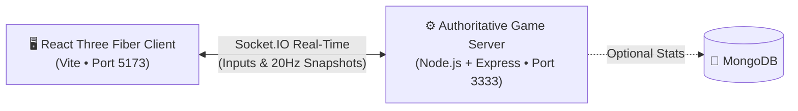

<div align="center">

# 🪂 Skyfall Royale
### เกม 3D Battle Royale มุมมองบุคคลที่ 3 เล่นผ่านเว็บเบราว์เซอร์แบบ Multiplayer
**React Three Fiber • Three.js • Node.js + Socket.IO • Authoritative Game Server**

<p>
  <a href="https://skyfall-royale-client.vercel.app">
    
  </a>
  
  
  
  
</p>

<p>
  <a href="#-ภาพรวมเกม">💡 ภาพรวม</a> •
  <a href="#-จุดเด่นของระบบ">✨ จุดเด่น</a> •
  <a href="#-ปุ่มควบคุมในเกม">🕹️ การควบคุม</a> •
  <a href="#-วิธีดาวน์โหลดและรันเล่นในเครื่อง">🚀 ติดตั้งและรัน</a> •
  <a href="#-สถาปัตยกรรมระบบ">🏗️ สถาปัตยกรรม</a> •
  <a href="#-การ-build-และ-deploy">🌐 Deploy</a>
</p>

</div>

---

## 💡 ภาพรวมเกม

**Skyfall Royale** คือต้นแบบเกม **3D Third-Person Battle Royale** ที่เล่นได้ทันทีบนเว็บเบราว์เซอร์ พัฒนาด้วย **TypeScript** แบบ Full-Stack Monorepo:
- **Client (ฝั่งผู้เล่น):** เรนเดอร์ฉากเกาะ 3 มิติด้วย **React Three Fiber + Three.js + Zustand** พร้อมเสียงสังเคราะห์แบบ Procedural Audio (ไม่ต้องโหลดไฟล์เสียงภายนอก)
- **Server (ฝั่งเซิร์ฟเวอร์):** **Node.js + Express + Socket.IO** แบบ Authoritative Server ความถี่ **~20 Hz** คำนวณการชนสิ่งกีดขวาง, วิถีกระสุน, วงพายุ (Storm Zone), กล่องแอร์ดรอป และเงื่อนไขชนะเกม
- **Database (ตัวเลือกเสริม):** รองรับ **MongoDB** สำหรับเก็บสถิติผู้เล่น (หากไม่ได้ตั้งค่า `MONGODB_URI` ตัวเกมก็ยังเล่นได้ปกติ!)

> 🌐 **ทดลองเปิดหน้าเว็บออนไลน์:** [https://skyfall-royale-client.vercel.app](https://skyfall-royale-client.vercel.app)

---

## ✨ จุดเด่นของระบบ

| ระบบ | รายละเอียดการทำงาน |
| :--- | :--- |
| 🏝️ **เกาะ 3 มิติ & สภาพแวดล้อม** | แผนที่เกาะพร้อมต้นไม้ หิน ซากปรักหักพังแบบ Instanced Meshes และระบบคำนวณชนสิ่งกีดขวางฝั่ง Server |
| 🔫 **ระบบการต่อสู้ & อาวุธ 4 ช่อง** | รองรับทั้งอาวุธยิงแบบ Hitscan (AR ยิงออโต้, Sniper ซูมเล็ง) และ Projectile (RPG) พร้อมเส้นกระสุน Tracer และตัวเลขดาเมจ |
| 🌪️ **วงพายุ (Storm Wall) & Air Drops** | กำแพงพายุบีบวงแบบเรียลไทม์พร้อมแถบเตือนบน HUD และกล่องเสบียง Air Drop |
| 🔊 **Procedural Web Audio** | สังเคราะห์เอฟเฟกต์เสียงในเกมผ่าน Web Audio API โดยตรง โหลดไวไม่ต้องใช้ไฟล์เสียงขนาดใหญ่ |
| 👥 **Multiplayer Real-Time** | ล็อบบี้ ห้องรอเล่น (Waiting Room), ยานพาหนะ, ระเบิดควัน, ช่องเก็บของ (Inventory) และท่าทาง Emote |

---

## 🕹️ ปุ่มควบคุมในเกม

| ปุ่ม / อุปกรณ์ | การทำงาน |
| :---: | :--- |
| <kbd>W</kbd> <kbd>A</kbd> <kbd>S</kbd> <kbd>D</kbd> | เดินเคลื่อนที่ตัวละคร |
| <kbd>Shift</kbd> | วิ่งเร็ว (Sprint) |
| <kbd>Space</kbd> | กระโดด (Jump) |
| **เมาส์ (Mouse)** | หันมุมกล้อง (คลิกกลางหน้าจอเพื่อเปิด Pointer Lock) |
| **คลิกซ้าย (LMB)** | ยิงอาวุธ (กดค้างเพื่อยิงอัตโนมัติสำหรับปืนกล AR) |
| **คลิกขวา (RMB)** | เล็งผ่านศูนย์เล็ง / ซูม (ADS — ซูมแรงสุดบนปืน Sniper) |
| <kbd>1</kbd> – <kbd>4</kbd> | สลับช่องอาวุธ |
| <kbd>R</kbd> | รีโหลดกระสุน (Reload) |
| <kbd>B</kbd> | กดท่าทาง Emote (แสดงให้ผู้เล่นคนอื่นเห็นด้วย) |

---

## 🚀 วิธีดาวน์โหลดและรันเล่นในเครื่อง

### ความต้องการของระบบ
- **Node.js 20 ขึ้นไป** และ **npm** ([ดาวน์โหลด Node.js](https://nodejs.org/))
- *(ไม่บังคับ)* **MongoDB** สำหรับเก็บสถิติผู้เล่นถาวร (ถ้าไม่มีสามารถรันเล่นได้ทันที)

### วิธีที่ 1: รันแบบ 1 คลิกบน Windows (แนะนำ ⚡)
1. กดปุ่ม **Code → Download ZIP** แล้วแตกไฟล์ (หรือ `git clone`)
2. ดับเบิลคลิกไฟล์ **`start-dev.bat`**
3. ระบบจะติดตั้ง Dependencies (`npm install`) ให้อัตโนมัติ และเปิดทั้ง **Game Server (`:3333`)** + **Web Client (`:5173`)** พร้อมเปิดหน้าเกมในเบราว์เซอร์!

### วิธีที่ 2: รันผ่าน Terminal (Windows / macOS / Linux)
```bash
# 1. โคลนโปรเจกต์
git clone https://github.com/newsoyes/skyfall-royale.git
cd skyfall-royale

# 2. ติดตั้งแพ็กเกจทั้งหมดจากโฟลเดอร์หลัก (npm workspaces)
npm install
# (หมายเหตุ: บน Windows PowerShell หากติด Execution Policy ให้ใช้ npm.cmd install)

# 3. สั่งรันทั้ง Server และ Client พร้อมกัน
npm run dev
```
หรือรันแยก 2 หน้าต่าง Terminal:
```bash
# Terminal 1 — Game Server (พอร์ต 3333)
cd server && npm run dev

# Terminal 2 — Vite Client (พอร์ต 5173)
cd client && npm run dev
```
จากนั้นเปิดเบราว์เซอร์ไปที่ **`http://localhost:5173`** ได้เลยครับ!

---

## ⚙️ การตั้งค่าตัวแปรแวดล้อม (Optional)

### ฝั่ง Client (`client/.env.local`)
```env
VITE_SERVER_URL=http://localhost:3333
```

### ฝั่ง Server (Environment Variables)
```bash
CLIENT_ORIGIN=http://localhost:5173
MONGODB_URI=mongodb://localhost:27017/skyfall   # ไม่ใส่ก็เล่นได้
PORT=3333
```

---

## 🏗️ สถาปัตยกรรมระบบ



```text
skyfall-royale/
├── client/                 # ฝั่งผู้เล่น 3D WebGL (React + Three.js + Zustand)
│   └── src/
│       ├── audio/          # เสียงสังเคราะห์ Procedural Audio
│       ├── game/           # ฉากเกาะ, อาวุธ, กระสุน, พายุ, ยานพาหนะ, กล้องบุคคลที่ 3
│       ├── net/            # การเชื่อมต่อ Socket.IO ฝั่ง Client
│       └── ui/             # หน้าล็อกอิน, ล็อบบี้, HUD, ช่องเก็บของ, สรุปผล
├── server/                 # เซิร์ฟเวอร์เกม Authoritative (Node.js + Socket.IO)
│   └── src/                # GameRoom.ts, terrain.ts, propColliders.ts, weapons.ts, db.ts
├── start-dev.bat           # สคริปต์รันเกมทันทีบน Windows
├── package.json            # Monorepo Workspaces Script
└── README.md               # คู่มือภาษาไทย
```

---

## 🌐 การ Build และ Deploy

```bash
# Build ฝั่ง Client และ Server สำหรับ Production
npm run build

# รัน Production Server
npm run start
```
- นำโฟลเดอร์ `client/dist/` ไป Deploy บน **Vercel / Netlify** แล้วตั้งค่า `VITE_SERVER_URL` ชี้ไปยัง URL ของ Socket.IO Server ที่ Deploy ไว้ (เช่น Render / Railway / VPS)

---

## 📄 สัญญาอนุญาต (License)

พัฒนาโดย **NEWSOYES** ([@newsoyes](https://github.com/newsoyes)) — เผยแพร่ภายใต้สัญญาอนุญาต [MIT License](LICENSE)
